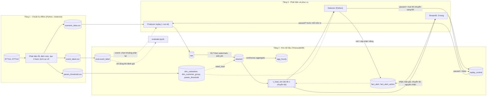

# Kiến trúc hệ thống

## 1. Tổng quan
Hệ thống phát lại dữ liệu cảm biến của 4 trạm biến áp vào kho dữ liệu chuỗi thời gian. Kho tự làm sạch và tổng hợp dữ liệu. Detector kiểm tra cảm biến, phát hiện quá tải và ghi cảnh báo. Khi một cảnh báo chuyển sang Đỏ, detector bật `replay_control.paused` và producer tự dừng. Người trực xử lý theo quy trình 3 bước (Xác nhận → Chuyển tải → Theo dõi) trên dashboard Streamlit, dashboard ghi thẳng vào DB. Xử lý xong thì dữ liệu chạy tiếp; tác dụng của chuyển tải được mô phỏng trên số đo thật.

Luồng chính: **Producer ⇄ `replay_control` ⇄ Detector → `fact_alert` ⇄ Streamlit**.

## 2. Các tầng

### Tầng 1: Chuẩn bị offline (Python, Jupyter)
| Task | Đầu ra | Nội dung |
|---|---|---|
| 1.1 Hiểu dữ liệu | `known_anomaly.csv` | 40 đoạn bất thường; đoạn lỗi bị loại khỏi hiệu chuẩn |
| 1.2 Định mức | `param_threshold.csv` | `rated_load = P99(S_H) × k`, tính trên 16 tháng đầu đã bỏ đoạn lỗi; Trạm Y = 19,479 × 1,05 = **20,45**; ngưỡng Vàng/Đỏ/đóng |
| 1.3 Kịch bản | `scenario_data.csv`, `event_label.csv` | 4 trạm × 8 tháng kiểm thử; 9 sự cố quá tải bơm vào; đáp án 38 sự cố |

- **Tải trạm:** `S_H = √(HUFL² + HULL²)`; `load_pct = S_H / rated_load × 100`.
- **4 trạm:** Trạm Y và Trạm 2 dùng ETT gốc (REAL). Trạm 3 và Trạm 4 dời +7 và +14 ngày (DERIVED).

### Tầng 2: Kho dữ liệu ELT (TimescaleDB)
Toàn bộ schema nằm trong `db/init/001_schema.sql`. File `002_load_data.sql` nạp 2 file CSV.

| Lớp | Đối tượng | Cơ chế |
|---|---|---|
| Raw | `raw` (hypertable) | Producer ghi nguyên vẹn, `ON CONFLICT (station_id, ts) DO NOTHING` nên chạy lại không trùng |
| Cleaned | `cleaned` (hypertable) | Thủ tục ELT chạy định kỳ bằng `add_job`, chỉ xử lý bản ghi mới theo `etl_watermark` (riêng từng trạm); tính `s_h`, `load_pct` |
| Tổng hợp | `agg_hourly` | Continuous aggregate, tự refresh mỗi phút, có real-time aggregation |
| Cảnh báo | `fact_alert`, `fact_alert_action` | Detector mở/cập nhật/đóng và trả tải; Streamlit ghi các bước của người trực và lượng chuyển tải |
| Mô phỏng | `v_load_sim` | Tải sau chuyển tải theo run: S_H đo − chuyển đi + nhận về |
| Điều khiển | `replay_control` | Detector bật dừng; producer đọc; Streamlit tắt dừng |
| Đáp án | `eval.event_label` | Schema riêng, chỉ dùng khi đánh giá |
| View | `v_station_latest`, `v_alert_queue` | Mức trạm theo cảnh báo đang mở; hàng đợi đã xếp hạng |

### Tầng 3: Phát hiện và phục vụ
- **Producer:** đọc `scenario_data.csv`, ghi từng mốc `ts` (đủ 4 trạm, 1 transaction) vào `raw`. Tham số `--speed`, `--start`/`--end`, `--event EVxxx` (phát `t_start − 2h` → `t_end + 2h`). Trước mỗi mốc `ts` đọc `replay_control.paused` của LIVE; đang dừng thì chờ (kiểm tra mỗi 1 giây), không bao giờ dừng giữa một mốc. Nhanh hơn ×60 thì in cảnh báo.
- **Detector:** đọc `v_load_sim`, xử lý tuần tự theo `ts` của dữ liệu (mọi trạm), một hàm phát hiện dùng chung cho `--source db` và `--source csv`. Quá tải xét trên tải sau chuyển tải; cảm biến kẹt xét trên S_H đo:
  1. **Kiểm tra cảm biến:** `s_h` không đổi ≥ 4 bản ghi → cảnh báo SENSOR, bỏ qua bước 2.
  2. **Kiểm tra quá tải:** tốc độ = `load_pct` − `load_pct` 4 bản ghi trước (%/giờ); TTB = (100 − `load_pct`) / tốc độ × 60, NULL khi tốc độ ≤ 0 hoặc `load_pct` ≥ 100.
     - Đỏ: ≥ 100% hoặc TTB ≤ 30 phút.
     - Vàng: ≥ 90% hoặc TTB ≤ 60 phút.
  3. **Vòng đời:** mở mới, cập nhật hoặc nâng Vàng → Đỏ. Đóng khi < 85% ở 2 lần đo liên tiếp. Cảnh báo ACK / ACTION_TAKEN vẫn được cập nhật số đo và đóng như thường; cột người trực nhập không bị ghi đè.
  4. **Dừng phát lại:** khi một cảnh báo *chuyển sang* Đỏ ở run LIVE → UPSERT `replay_control` (`paused = true`, `paused_at_ts = ts`, `reason = alert_id`). EVAL_A / EVAL_B không ghi.
  6. **Trả tải:** khi tải đo của trạm nguồn < 85% hai lần liên tiếp → đặt `effective_to_ts` cho các lần chuyển tải đang hiệu lực.
  5. **Báo giả:** cảnh báo bị đóng từ dashboard thì detector im lặng với đợt quá tải đó cho đến khi tải tự hạ dưới ngưỡng đóng.
- **Streamlit (`dashboard/`):** 3 trang: Điều hành (tình trạng trạm, hàng đợi, kết quả xử lý sự cố Đỏ) · Chi tiết trạm (một layout, chèn khung xử lý 3 bước khi có Đỏ) · Báo cáo quản trị (4 KPI trên cảnh báo Đỏ kèm mục tiêu và Đạt/Chưa đạt: nhận TB ≤ 3', chuyển tải TB ≤ 16', Đỏ bị bỏ lỡ = 0, báo giả / tổng chỉ để theo dõi; biểu đồ cảnh báo theo trạm × mức; bảng kết quả xử lý sự cố Đỏ). Một người trực "Người trực A". Tự làm mới mỗi 5 giây (`st.fragment(run_every=5)`); mọi mốc giờ thật ghi bằng `now()` phía DB.

## 3. Quy trình Red Alert (3 bước, mục tiêu ≤ 16 phút)

| Bước | Người trực | Hệ thống hiển thị / ghi |
|---|---|---|
| ① Xác nhận | "Xác nhận – quá tải thật" hoặc "Báo giả" (dựa trên số liệu hiện tại và biểu đồ ngay bên dưới) | Ghi `acked_*`, `verdict`, `verified_at`. Báo giả đóng ngay (`RESOLVED`, `resolved_ts = last_ts`) |
| ② Chuyển tải | Xác nhận lượng X chuyển sang trạm lân cận | Cần giảm ngay = S_H − 0,85 × định mức; cần giảm nếu tải tiếp tục tăng 1 giờ; trạm lân cận nhận thêm tối đa = 0,9 × định mức lân cận − S_H lân cận; gợi ý X và xem trước tải hai trạm. Ghi `fact_alert_action` (`effective_from_ts` = mốc dữ liệu hiện tại), `ACTION_TAKEN`, `action_done_at` |
| ③ Theo dõi | Xem tải sau chuyển; chuyển thêm nếu vẫn ≥ 90%; ghi nguyên nhân | Biểu đồ tải đo (nét đứt) và tải mô phỏng (nét liền). Cảnh báo tự đóng khi tải mô phỏng < 85% hai lần; chuyển tải tự trả khi TẢI ĐO < 85% hai lần |

- **Tác dụng của hành động là mô phỏng:** dữ liệu là lịch sử nên lưới không đổi thật. View `v_load_sim` tính tải trạm nguồn = S_H đo − X, trạm nhận = S_H đo + X, từ mốc dữ liệu sau lúc xác nhận. `cleaned` giữ nguyên số đo.
- Dưới mỗi bước đã xong, thanh bước ghi giờ thật và thời gian kể từ lúc mở (① `verified_at`, ② `action_done_at`, ③ `resolved_at`).
- Khi cảnh báo đã tự đóng, trang Chi tiết trạm giữ thẻ **Kết quả xử lý sự cố Đỏ gần nhất** (cảnh báo Đỏ thật gần nhất): 3 bước kèm giờ, thời gian chuyển tải so với 16', lượng đã chuyển, trạng thái chuyển tải (đang hiệu lực / đã trả lúc …), ô nguyên nhân. Thanh tiêu đề trang chỉ còn tên trạm.
- Sau "Xác nhận chuyển tải" hoặc "Báo giả": nếu không còn cảnh báo Đỏ nào ở OPEN / ACK thì `replay_control.paused = false`. Dashboard không hiển thị trạng thái phát lại.
- **Kiểm thử:** phát lại một đoạn quá tải thật kéo dài của Trạm Y (`scripts/replay_event.sh EV029 60`), không tiêm lỗi nhân tạo.

| Run | Dừng khi Đỏ | Dùng cho |
|---|---|---|
| `LIVE` | Có | Phát lại qua DB, dashboard |
| `EVAL_A`, `EVAL_B` | Không | Đánh giá phương pháp phát hiện trên CSV |

## 4. Luồng xử lý một bản ghi
1. Producer đọc `replay_control.paused`; nếu không dừng thì ghi mốc `ts` vào `raw` (`ingested_at` = giờ ghi).
2. Job ELT chuyển sang `cleaned`, tính `s_h`, `load_pct`, ghi `processed_at`, rồi cập nhật watermark.
3. `agg_hourly` tự cập nhật.
4. Detector đọc bản ghi mới theo thứ tự `ts`; mở, nâng mức hoặc đóng cảnh báo trong `fact_alert` (`opened_at` = giờ ghi). Chuyển sang Đỏ → bật `replay_control.paused`.
5. Streamlit hiển thị cảnh báo; người trực đi qua 3 bước → `acked_at`, `verified_at`, `action_done_at`; xong thì phát lại chạy tiếp và tải mô phỏng giảm từ mốc kế tiếp.

- **Độ trễ hệ thống** = `opened_at` − `ingested_at`.
- **Thời gian phản ứng** = `acked_at` − `opened_at`; **thời gian chuyển tải Đỏ** = `action_done_at` − `opened_at`.

## 5. Quyết định thiết kế

| Quyết định | Lý do |
|---|---|
| Hai đồng hồ: `*_ts` là thời gian dữ liệu, `*_at` là giờ thật | Phát hiện và đánh giá không phụ thuộc tốc độ replay; giờ thật chỉ dùng đo người phản ứng |
| Producer tự dừng khi có Đỏ (`replay_control`) | Thời gian dữ liệu đứng yên trong lúc người trực xử lý, TTB lúc mở vẫn có ý nghĩa khi phát nhanh |
| Tác dụng chuyển tải được mô phỏng (`v_load_sim`), số đo gốc giữ nguyên | Dữ liệu là lịch sử nên không đổi thật; mô phỏng cho phép kiểm chứng hành động có đủ hay không, và hai đường đo / mô phỏng cùng hiện để minh bạch |
| Kiểm thử bằng phát lại sự cố quá tải thật, không tiêm lỗi | Tình huống thật, không phụ thuộc giả định về hình dạng lỗi |
| Một run vận hành LIVE, một người trực | Tránh nhầm run (màu trạm theo run khác); dashboard đơn giản |
| Streamlit thay Grafana + FastAPI | Một ứng dụng vừa hiển thị vừa ghi DB trực tiếp; giờ thật vẫn lấy bằng `now()` trong DB. Grafana và FastAPI được giữ ở `archive/` |
| Giữ `ts` gốc 2017–2018, không dời về hiện tại | Đáp án `event_label` khớp trực tiếp, không cần dời theo |
| `raw` và `cleaned` không có cột nhãn nguồn | Detector không thể "nhìn trộm" đáp án |
| Đáp án ở schema `eval` riêng | Tách rõ dữ liệu vận hành và dữ liệu đánh giá |
| Một bảng `fact_alert` cho mọi `run_id` (LIVE / EVAL_A / EVAL_B) | Không cần bảng riêng; dashboard lọc `run_id = LIVE` |
| Mỗi (run, trạm, loại) chỉ 1 cảnh báo đang mở (OPEN / ACK / ACTION_TAKEN) | Một sự cố chỉ tạo 1 cảnh báo, danh sách gọn |
| Mức trạm lấy theo cảnh báo đang mở, không theo ngưỡng % | Ô trạm và hàng đợi luôn cùng màu |
| Xếp hạng: mức → TTB (khung 10 phút) → khách hàng ưu tiên → `load_pct`, không tính điểm có trọng số | Đơn giản, dễ giải thích; khách hàng ưu tiên chỉ phân xử khi cùng mức và TTB gần nhau |
| Watermark tính riêng từng trạm | Producer ghi xen kẽ 4 trạm cùng `ts`; một mốc chung có thể bỏ sót trạm |
| Không dùng `dim_time` | Kho chuỗi thời gian dùng thẳng `ts` với `time_bucket` |
| Mọi tham số chỉ tính trên 16 tháng đầu | Tránh rò rỉ dữ liệu sang giai đoạn kiểm thử |

## 6. Công nghệ

| Thành phần | Công nghệ |
|---|---|
| Chuẩn bị dữ liệu | Python, pandas, numpy, matplotlib, Jupyter |
| Producer, detector | Python + psycopg |
| Kho dữ liệu | TimescaleDB ≥ 2.13 (PostgreSQL 16): hypertable, continuous aggregate, job scheduler |
| Dashboard | Streamlit + psycopg + Altair (cổng 8501) |
| Hạ tầng | Docker Compose |

## 7. Hạn chế
- Chỉ có 2 trạm thật; Trạm 3 và Trạm 4 là bản dời ngày.
- Sự cố bơm chỉ nằm trong 01–02/2018, vì chỉ mùa đông tải buổi tối mới đủ cao.
- Cần 1 giờ (4 bản ghi) mới nhận ra cảm biến đứng yên.
- TTB giả định tải tăng đều; khi tải chững lại, dự báo bi quan hơn thực tế.
- Tác dụng của chuyển tải là mô phỏng (S_H ± X), hệ thống không điều khiển lưới.
- Dừng dữ liệu khi diễn tập là một giả định về thời gian.
- Leo thang Vàng (15 phút) chỉ có ý nghĩa khi vận hành thật (×1).
- Định mức và hệ số k là giả định của nhóm.
- Không xử lý trường hợp trạm dự phòng cũng cao tải; không tính tổn thất điện năng.
