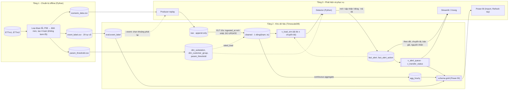

# Kiến trúc hệ thống (v2)

## 1. Tổng quan
Hệ thống phát lại dữ liệu cảm biến của 4 trạm biến áp vào kho dữ liệu chuỗi thời gian. Kho tự làm sạch (loại trùng) và tổng hợp dữ liệu. Detector kiểm tra cảm biến, phát hiện quá tải và ghi cảnh báo. **Dữ liệu không dừng khi lên Đỏ**: người trực xử lý trong lúc dữ liệu vẫn chạy, thời hạn tính theo giờ dữ liệu (Đỏ ≤ 30 phút đến lúc chuyển tải, Vàng ≤ 60 phút đến lúc theo dõi). Tác dụng chuyển tải được mô phỏng trên số đo thật. Power BI phân tích hai nguồn: lịch sử 8 tháng (run HISTORY) và các lần phát lại có người trực (run LIVE).

Luồng chính: **Producer → raw → ELT → cleaned → Detector → `fact_alert` ⇄ Streamlit**; **gold views → Power BI**.

## 2. Các tầng

### Tầng 1: Chuẩn bị offline
| Task | Đầu ra | Nội dung |
|---|---|---|
| 1.1 Hiểu dữ liệu | `known_anomaly.csv` | Đoạn bất thường (tải = 0, tải đứng yên); đoạn lỗi bị loại khỏi hiệu chuẩn |
| 1.2 Định mức | `param_threshold.csv` | `rated_load = P99(S_H) × k`, tính trên **16 tháng đầu** đã bỏ đoạn lỗi; Trạm Y = 19,479 × 1,05 = **20,45** |
| 1.3 Kịch bản | `scenario_data.csv`, `event_label.csv` | `scripts/build_scenario.py`: 4 trạm × 8 tháng kiểm thử từ ETT gốc, **không bơm lỗi**; đáp án **29** sự cố (9 quá tải đều ở Trạm Y + 20 lỗi cảm biến) |

- **Tải trạm:** `S_H = √(HUFL² + HULL²)`; `load_pct = S_H / rated_load × 100`.
- **Giả định H ≈ M + L** đúng 97% (ETTm1) và 80% (ETTm2); đoạn không tuân theo bị loại khi tính P99.
- **4 trạm:** Trạm Y và Trạm 2 dùng ETT gốc (REAL). Trạm 3 = ETTm1 dời 7 ngày, Trạm 4 = ETTm2 dời 14 ngày (DERIVED).
- **Ghi chú dữ liệu:** giá trị âm ở MUFL/LUFL… là đặc điểm của bộ dữ liệu gốc (S_H chỉ dùng HUFL, HULL). Tải Trạm 2 giảm dần ở năm gần nhất nên ở 8 tháng kiểm thử chỉ lên tối đa Vàng.

### Tầng 2: Kho dữ liệu ELT (TimescaleDB)
Bảng trong `db/init/001_schema.sql`; nạp CSV trong `002_load_data.sql`; view trong `003_views.sql`. Nâng cấp DB cũ: `sql/migrate_v2.sql`.

| Lớp | Đối tượng | Cơ chế |
|---|---|---|
| Raw | `raw` (hypertable) | **Append-only**, không khóa chính, giữ `ingested_at`. Producer chỉ `INSERT` |
| Cleaned | `cleaned` (hypertable) | Thủ tục ELT (`add_job`, 10 giây): chọn bản `ingested_at` mới nhất cho mỗi (trạm, ts), tính `s_h`, `load_pct`, `ON CONFLICT DO UPDATE` khi bản mới hơn. Watermark theo `ingested_at` từng trạm, quét lùi 1 phút |
| Tổng hợp | `agg_hourly` | Continuous aggregate, tự refresh mỗi phút |
| Cảnh báo | `fact_alert`, `fact_alert_action` | Detector mở/cập nhật/đóng và trả tải; Streamlit ghi thao tác người trực |
| Mô phỏng | `v_load_sim` | Tải sau chuyển tải theo run: S_H đo − chuyển đi + nhận về |
| Đồng hồ | `v_data_clock` | Mốc dữ liệu mới nhất của mỗi trạm (mọi thời hạn tính theo đây) |
| View | `v_station_latest`, `v_alert_queue`, `v_transfer_status` | Mức trạm; hàng đợi + thời hạn / quá hạn / bỏ lỡ / trễ; chuyển tải quá hạn |
| Đáp án | `eval.event_label` | Schema riêng, chỉ dùng khi phân tích |
| Gold | schema `gold` (`powerbi/gold_views.sql`) | View cho Power BI |

### Tầng 3: Phát hiện và phục vụ
- **Producer:** ghi từng mốc `ts` (đủ 4 trạm, 1 transaction) vào `raw`. Tham số `--speed` (demo ×20), `--start`/`--end`, `--event EVxxx` (phát `t_start − 2h` → `t_end + 2h`). **Không dừng** khi có Đỏ.
- **Detector:** đọc `v_load_sim`, xử lý tuần tự theo `ts`. Một phương pháp duy nhất. Quá tải xét trên tải sau chuyển tải; cảm biến kẹt xét trên S_H đo:
  1. **Kiểm tra cảm biến:** `s_h` không đổi ≥ 4 bản ghi → cảnh báo SENSOR, bỏ qua bước 2.
  2. **Kiểm tra quá tải:** tốc độ = `load_pct` − `load_pct` 4 bản ghi trước (%/giờ, tải đo); TTB = (100 − `load_pct`) / tốc độ × 60.
     - Đỏ: ≥ 100% hoặc TTB ≤ 30 phút. Vàng: ≥ 90% hoặc TTB ≤ 60 phút.
  3. **Vòng đời:** mở mới, cập nhật hoặc nâng Vàng → Đỏ. Đóng khi < 85% ở 2 lần đo liên tiếp. Khi mở cảnh báo mà trạm đang nhận tải → ghi `received_load`.
  4. **Trả tải** (theo tải đo của trạm nguồn): `SAFE` khi < 85% hai lần liên tiếp; `TIMEOUT` khi đã chuyển ≥ 2 giờ và < 90%. Ghi `effective_to_ts`, `return_reason`.
  5. **Báo giả:** cảnh báo bị đóng từ dashboard thì detector im lặng với đợt quá tải đó cho đến khi tải tự hạ dưới ngưỡng đóng.
- **Streamlit (`dashboard/`):** Điều hành · Chi tiết trạm · Báo cáo quản trị (mục 3). Một người trực "Người trực A". Tự làm mới mỗi 5 giây.
- **Power BI (`powerbi/CanhBaoQuaTai_v2`):** 5 trang theo 5 nhóm câu hỏi, đọc schema `gold` của `energy_history` và `energy`.

## 3. Quy trình xử lý (thời hạn theo giờ dữ liệu)

| Mức | Người trực | Hệ thống ghi | Thời hạn |
|---|---|---|---|
| **Vàng** | Bấm **Theo dõi** (hàng đợi hoặc trang trạm) | `status = ACK`, `acked_by`, `acked_at`, `acked_ts` | ≤ 60 phút kể từ `opened_ts` |
| **Đỏ** | Một khung chuyển tải: lượng điền sẵn, trạng thái trạm nhận → **Xác nhận chuyển tải**; hoặc **Báo giả** | Chuyển tải: `verdict = REAL`, `acked_*` (nếu chưa có), `action_done_at`, `action_ts`, `ACTION_TAKEN`, dòng `fact_alert_action`. Báo giả: `verdict = FALSE_ALARM`, đóng ngay | `action_ts − escalated_ts` ≤ 30 phút |
| **Cảm biến** | **Chuyển bảo trì** | `root_cause = SENSOR_MAINTENANCE` | Không đặt |

- Lượng gợi ý = max(S_H − 0,85 × định mức, dự báo 1 giờ). Trạm nhận tối đa = 0,9 × định mức trạm nhận − S_H trạm nhận; DB kiểm tra lại lúc ghi (vượt thì không ghi).
- Chuyển tải có tác dụng từ mốc dữ liệu kế tiếp. Cảnh báo tự đóng khi tải mô phỏng < 85% hai lần.
- **Chuyển tải quá hạn:** còn hiệu lực ≥ 2 giờ dữ liệu (tải đo vẫn ≥ 90%) → cờ đỏ ở ô trạm, trang trạm và báo cáo.
- **Không ai xử lý:** cảnh báo giữ nguyên tới khi dữ liệu trở lại bình thường. Đỏ tự đóng mà không chuyển tải, không báo giả → **bị bỏ lỡ**. Chuyển tải sau 30 phút → **trễ**.
- **Kiểm thử:** `scripts/replay_event.sh EV029` (×20) và `scripts/simulate_operator.py` (giả lập đúng hạn / trễ / bỏ qua / báo giả bằng chính hàm ghi của dashboard).

| Run | DB | Người trực | Dùng cho |
|---|---|---|---|
| `LIVE` | `energy` | Có (Streamlit) | Vận hành, Power BI trang 3–4 |
| `HISTORY` | `energy_history` | Không (mọi Đỏ thành "bỏ lỡ") | Power BI trang 1, 2, 5 |

## 4. Luồng xử lý một bản ghi
1. Producer ghi mốc `ts` vào `raw` (`ingested_at` = giờ ghi).
2. Job ELT chọn bản mới nhất, ghi/ghi đè `cleaned`, cập nhật watermark.
3. `agg_hourly` tự cập nhật.
4. Detector đọc bản ghi mới theo thứ tự `ts`; mở, nâng mức, đóng cảnh báo; trả tải.
5. Streamlit hiển thị cảnh báo và đồng hồ giờ dữ liệu; người trực thao tác; tải mô phỏng đổi từ mốc kế tiếp.

- **Độ trễ hệ thống** = `opened_at` − `ingested_at`.
- **KPI Đỏ** = `action_ts` − `escalated_ts` (giờ dữ liệu); **KPI Vàng** = `acked_ts` − `opened_ts`.

## 5. Quyết định thiết kế

| Quyết định | Lý do |
|---|---|
| Không dừng dữ liệu khi lên Đỏ (bỏ `replay_control`) | Lưới thật không chờ người trực; cho phép đo được tình huống trễ / bỏ lỡ |
| Thời hạn theo giờ dữ liệu (30′ / 60′) | Không phụ thuộc tốc độ phát; ×20 tương đương 1′30″ / 3′ thật |
| Đỏ: một khung chuyển tải, bấm là ghi quá tải thật | Bớt một bước; quyết định quan trọng là có chuyển tải hay không |
| `raw` append-only, `cleaned` lấy bản mới nhất | Giữ nguyên lịch sử nhận dữ liệu; bản sửa muộn ghi đè đúng |
| Trả tải SAFE / TIMEOUT, cờ quá hạn sau 2 giờ | Không giữ chuyển tải vô thời hạn; biết lần chuyển nào hiệu quả |
| Tác dụng chuyển tải được mô phỏng (`v_load_sim`) | Dữ liệu là lịch sử nên không đổi thật; hai đường đo / mô phỏng cùng hiện để minh bạch |
| Kịch bản chỉ dùng lỗi thật, không bơm lỗi | Kết quả không phụ thuộc giả định về hình dạng lỗi |
| Hai run LIVE / HISTORY, hai DB | Phát lại có người trực không lẫn với phân tích toàn kỳ |
| Bỏ phương pháp A và đánh giá A/B | Một phương pháp vận hành duy nhất; báo cáo tập trung vào câu hỏi nghiệp vụ |
| `raw` và `cleaned` không có cột nhãn; đáp án ở schema `eval` | Detector không thể "nhìn trộm" đáp án |
| Mỗi (run, trạm, loại) chỉ 1 cảnh báo đang mở | Một sự cố chỉ tạo 1 cảnh báo |
| Xếp hạng: mức → TTB (khung 10 phút) → khách hàng ưu tiên → `load_pct` | Đơn giản, dễ giải thích |
| Mọi tham số chỉ tính trên 16 tháng đầu | Tránh rò rỉ dữ liệu sang giai đoạn kiểm thử |

## 6. Công nghệ

| Thành phần | Công nghệ |
|---|---|
| Chuẩn bị dữ liệu | Python |
| Producer, detector | Python + psycopg |
| Kho dữ liệu | TimescaleDB ≥ 2.13 (PostgreSQL 16): hypertable, continuous aggregate, job scheduler |
| Dashboard | Streamlit + psycopg + Altair (cổng 8501) |
| Báo cáo | Power BI Desktop (PBIP, Import qua PostgreSQL connector) |
| Hạ tầng | Docker Compose |

## 7. Hạn chế
- Chỉ có 2 trạm thật; Trạm 3 và Trạm 4 là bản dời ngày.
- Cần 1 giờ (4 bản ghi) mới nhận ra cảm biến đứng yên.
- TTB giả định tải tăng đều; nhạy với dao động ngắn nên sinh nhiều cảnh báo không khớp sự cố.
- Tác dụng của chuyển tải là mô phỏng (S_H ± X), hệ thống không điều khiển lưới.
- Câu hỏi "thời gian phản ứng có cải thiện qua các tháng" chỉ trả lời được khi có đủ lần phát lại LIVE.
- Định mức và hệ số k là giả định của nhóm.
- Không xử lý trường hợp trạm dự phòng cũng cao tải; không tính tổn thất điện năng.
