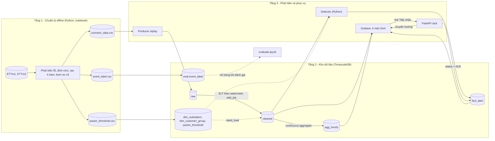

# Kiến trúc hệ thống

## 1. Tổng quan
Hệ thống phát lại dữ liệu cảm biến của 4 trạm biến áp vào kho dữ liệu chuỗi thời gian. Kho tự làm sạch và tổng hợp dữ liệu. Detector kiểm tra cảm biến, phát hiện quá tải và ghi cảnh báo. Grafana hiển thị cảnh báo; người trực bấm "Tiếp nhận" và FastAPI ghi nhận.

## 2. Các tầng

### Tầng 1: Chuẩn bị offline (Python, Jupyter)
| Task | Đầu ra | Nội dung |
|---|---|---|
| 1.1 Hiểu dữ liệu | `known_anomaly.csv` | 40 đoạn bất thường; đoạn lỗi bị loại khỏi hiệu chuẩn |
| 1.2 Định mức | `param_threshold.csv` | `rated_load = P99(S_H) × k`, tính trên 16 tháng đầu đã bỏ đoạn lỗi; ngưỡng Vàng/Đỏ/đóng |
| 1.3 Kịch bản | `scenario_data.csv`, `event_label.csv` | 4 trạm × 8 tháng kiểm thử; 9 sự cố quá tải bơm vào; đáp án 38 sự cố |

- **Tải trạm:** `S_H = √(HUFL² + HULL²)`.
- **4 trạm:** Trạm Y và Trạm 2 dùng ETT gốc (REAL). Trạm 3 và Trạm 4 dời +7 và +14 ngày (DERIVED).

### Tầng 2: Kho dữ liệu ELT (TimescaleDB)
Toàn bộ schema nằm trong `db/init/001_schema.sql`. File `002_load_data.sql` nạp 2 file CSV.

| Lớp | Đối tượng | Cơ chế |
|---|---|---|
| Raw | `raw` (hypertable) | Producer ghi nguyên vẹn, `ON CONFLICT (station_id, ts) DO NOTHING` nên chạy lại không trùng |
| Cleaned | `cleaned` (hypertable) | Thủ tục ELT chạy định kỳ bằng `add_job`, chỉ xử lý bản ghi mới theo `etl_watermark` (riêng từng trạm); tính `s_h`, `load_pct` |
| Tổng hợp | `agg_hourly` | Continuous aggregate, tự refresh mỗi phút, có real-time aggregation |
| Cảnh báo | `fact_alert` | Detector ghi; FastAPI cập nhật ACK |
| Đáp án | `eval.event_label` | Schema riêng, chỉ dùng khi đánh giá |
| View | `v_station_latest`, `v_alert_queue` | Phục vụ màn hình tổng quan và danh sách cảnh báo |

### Tầng 3: Phát hiện và phục vụ
- **Producer:** đọc `scenario_data.csv`, ghi từng dòng vào `raw` theo thứ tự `ts`. Tham số `--speed` (×1, ×10, ×60…) và `--start` (ngày bắt đầu phát).
- **Detector:** đọc `cleaned`, xử lý từng bản ghi theo thứ tự `ts` của dữ liệu:
  1. **Kiểm tra cảm biến:** `s_h` không đổi ≥ 4 bản ghi → cảnh báo SENSOR, bỏ qua bước 2.
  2. **Kiểm tra quá tải:** tốc độ = `load_pct` − `load_pct` 1 giờ trước; TTB = (100 − `load_pct`) / tốc độ × 60.
     - Đỏ: ≥ 100% hoặc TTB ≤ 30 phút.
     - Vàng: ≥ 90% hoặc TTB ≤ 60 phút.
  3. **Vòng đời:** mở mới, cập nhật hoặc nâng Vàng → Đỏ. Đóng khi < 85% ở 2 lần đo liên tiếp.
  - Hai chế độ dùng chung một hàm phát hiện: `--source db` ghi `fact_alert`; `--source csv` xuất `alerts_A.csv` / `alerts_B.csv` cho đánh giá.
- **Grafana:** đọc `cleaned`, `agg_hourly`, `fact_alert` và các view; tự làm mới mỗi 5–10 giây.
- **FastAPI:** `GET /ack?alert_id=…&user=…` → `status = ACK`, ghi `acked_by`, `acked_at = now()`, rồi chuyển về Grafana.

## 3. Luồng xử lý một bản ghi
1. Producer ghi bản ghi vào `raw` (`ingested_at` = giờ ghi).
2. Job ELT chuyển sang `cleaned`, tính `s_h`, `load_pct`, ghi `processed_at`, rồi cập nhật watermark.
3. `agg_hourly` tự cập nhật.
4. Detector đọc bản ghi mới; mở, nâng mức hoặc đóng cảnh báo trong `fact_alert` (`opened_at` = giờ ghi).
5. Grafana hiển thị cảnh báo; người trực bấm "Tiếp nhận" → `acked_at`.

- **Độ trễ hệ thống** = `opened_at` − `ingested_at`.
- **Thời gian phản ứng của người trực** = `acked_at` − `opened_at`.

## 4. Quyết định thiết kế

| Quyết định | Lý do |
|---|---|
| Hai đồng hồ: `*_ts` là thời gian dữ liệu, `*_at` là giờ thật | Phát hiện và đánh giá không phụ thuộc tốc độ replay; giờ thật chỉ dùng đo người phản ứng |
| Giữ `ts` gốc 2017–2018, không dời về hiện tại | Đáp án `event_label` khớp trực tiếp, không cần dời theo. Grafana chọn khoảng thời gian theo dữ liệu, múi giờ UTC |
| `raw` và `cleaned` không có cột nhãn nguồn | Detector không thể "nhìn trộm" đáp án |
| Đáp án ở schema `eval` riêng | Tách rõ dữ liệu vận hành và dữ liệu đánh giá |
| Đánh giá dùng `run_id` (LIVE / EVAL_A / EVAL_B / DRILL) trong cùng `fact_alert` | Không cần bảng riêng; dashboard lọc `run_id = 'LIVE'` |
| Mỗi (run, trạm, loại) chỉ 1 cảnh báo đang mở | Một sự cố chỉ tạo 1 cảnh báo, danh sách gọn |
| Watermark tính riêng từng trạm | Producer ghi xen kẽ 4 trạm cùng `ts`; một mốc chung có thể bỏ sót trạm |
| Xếp hạng theo mức → TTB → `load_pct`, không tính điểm có trọng số | Đơn giản, dễ giải thích, không phải chốt trọng số |
| Không dùng `dim_time` | Kho chuỗi thời gian dùng thẳng `ts` với `time_bucket` |
| Mọi tham số chỉ tính trên 16 tháng đầu | Tránh rò rỉ dữ liệu sang giai đoạn kiểm thử |

## 5. Công nghệ

| Thành phần | Công nghệ |
|---|---|
| Chuẩn bị dữ liệu | Python, pandas, numpy, matplotlib, Jupyter |
| Producer, detector | Python + psycopg |
| Kho dữ liệu | TimescaleDB ≥ 2.13 (PostgreSQL 16): hypertable, continuous aggregate, job scheduler |
| Dashboard | Grafana (datasource PostgreSQL) |
| API tiếp nhận | FastAPI + Uvicorn |
| Hạ tầng | Docker Compose |

## 6. Hạn chế
- Chỉ có 2 trạm thật; Trạm 3 và Trạm 4 là bản dời ngày.
- Sự cố bơm chỉ nằm trong 01–02/2018, vì chỉ mùa đông tải buổi tối mới đủ cao.
- Cần 1 giờ (4 bản ghi) mới nhận ra cảm biến đứng yên.
- TTB giả định tải tăng đều; khi tải chững lại, dự báo bi quan hơn thực tế.