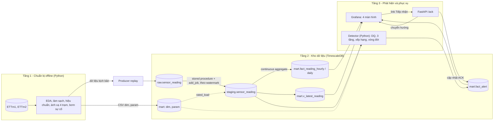

# Kiến trúc hệ thống

## 1. Tổng quan
Hệ thống nhận dữ liệu cảm biến của 4 trạm biến áp. Dữ liệu được đưa vào kho dữ liệu chuỗi thời gian và làm sạch theo từng lớp. Sau đó hệ thống phát hiện bất thường, xếp hạng cảnh báo và hiển thị trên dashboard để Giám đốc Kỹ thuật tiếp nhận và ra quyết định điều phối.

## 2. Các tầng

### Tầng 1: Chuẩn bị offline (Python, Jupyter)
- **EDA:** chu kỳ tải, phân phối, P95/P99, độ trễ giữa tải và nhiệt độ dầu (OT).
- **Hiệu chuẩn trên 16 tháng đầu:**
  - `rated_load` = P99(HUFL) × hệ số trạm.
  - Ngưỡng bật/tắt cảnh báo.
  - Hồ sơ z-score theo giờ × thứ.
- **Tạo 4 trạm:**
  - Trạm 1–2 là ETT gốc (REAL).
  - Trạm 3–4 được dời 7–14 ngày và thêm nhiễu (DERIVED).
- **Bơm sự cố** (SIMULATED) và ghi nhãn sự cố vào `eval_event_label`.
- **Đầu ra:** dữ liệu kịch bản cho 8 tháng cuối và các file CSV tham chiếu.

### Tầng 2: Kho dữ liệu ELT (TimescaleDB, toàn bộ bằng SQL)

| Lớp | Đối tượng | Cơ chế |
|---|---|---|
| Raw (Bronze) | `raw.sensor_reading` | Producer ghi nguyên vẹn. Dùng `ON CONFLICT DO NOTHING` nên chạy lại không bị trùng |
| Staging (Silver) | `staging.sensor_reading` | Stored procedure chạy định kỳ bằng `add_job`, chỉ xử lý dữ liệu mới theo `etl_watermark` |
| Mart (Gold) | `fact_reading_hourly`, `fact_reading_daily` | Continuous aggregate, tự refresh bằng policy, có real-time aggregation |
| Mart (Gold) | `fact_alert` | Do detector ghi và cập nhật |
| Mart (Gold) | `v_latest_reading` | View lấy bản ghi mới nhất của từng trạm |

### Tầng 3: Phát hiện và phục vụ
- **Detector (Python, chạy vòng lặp định kỳ):** đọc Staging rồi xử lý theo thứ tự:
  1. Kiểm tra chất lượng theo cửa sổ thời gian.
  2. Chạy 3 tầng phát hiện: ngưỡng, z-score, xu hướng kèm time-to-breach.
  3. Phân mức Đỏ/Vàng.
  4. Tính điểm ưu tiên.
  5. Quản lý vòng đời và ghi vào `fact_alert`.
- **Grafana:** chỉ đọc lớp Mart. Dashboard tự làm mới mỗi 5–10 giây.
- **FastAPI:** nhận link "Tiếp nhận" từ Grafana, cập nhật `status`, `acked_at`, `acked_by`, rồi chuyển người dùng về lại Grafana.

## 3. Luồng xử lý một bản ghi
1. Producer ghi bản ghi vào Raw. Lúc này `ingested_at` = thời điểm ghi.
2. Job ELT chuyển bản ghi sang Staging, gồm các bước:
   - tính `total_load = HUFL`, `load_pct`, `balance_gap`;
   - gắn `dq_flag`;
   - ghi `processed_at`.
3. Continuous aggregate tự cập nhật giá trị theo giờ và theo ngày.
4. Detector đọc bản ghi mới, rồi mở, nâng mức hoặc đóng cảnh báo trong `fact_alert`.
5. Grafana hiển thị cảnh báo. Người vận hành bấm "Tiếp nhận", FastAPI ghi nhận ACK.

Độ trễ end-to-end được đo bằng chênh lệch giữa `ingested_at`, `processed_at` và `opened_at`.

## 4. Quyết định thiết kế

| Quyết định | Lý do |
|---|---|
| 3 lớp raw → staging → mart | Tách rõ dữ liệu gốc, dữ liệu đã làm sạch và dữ liệu phục vụ; dễ truy vết khi có lỗi |
| Dim và param là dữ liệu tham chiếu, nạp trước pipeline | Staging cần `rated_load` để tính `load_pct`. Đây là ngoại lệ có chủ đích cho quy tắc "lớp dưới không đọc lớp trên" |
| Chia việc kiểm tra chất lượng: Staging xét từng dòng, Detector xét theo cửa sổ thời gian | Stored procedure không phát hiện được lỗi kéo dài như đứng yên hay mất dữ liệu |
| Grafana chỉ đọc Mart | Giữ đúng phân lớp, dashboard không phụ thuộc vào cấu trúc Staging |
| Tách `eval_alert` khỏi `fact_alert` | Thực nghiệm 3 phương pháp không làm lẫn cảnh báo trên dashboard vận hành |
| Không dùng `dim_time` | Kho chuỗi thời gian dùng trực tiếp `ts` với `time_bucket` và `EXTRACT` |
| Chỉ hiệu chuẩn trên 16 tháng đầu | Tránh rò rỉ dữ liệu sang giai đoạn đánh giá |

## 5. Công nghệ

| Thành phần | Công nghệ |
|---|---|
| Chuẩn bị dữ liệu | Python, pandas, numpy, matplotlib, Jupyter |
| Ingestion | Python + psycopg |
| Kho dữ liệu | TimescaleDB (PostgreSQL 16): hypertable, continuous aggregate, job scheduler |
| Phát hiện | Python (pandas, psycopg) |
| Dashboard | Grafana (datasource PostgreSQL) |
| API tiếp nhận | FastAPI + Uvicorn |
| Hạ tầng | Docker Compose |

## 6. Vấn đề còn mở
- **Thời gian replay:** dữ liệu gốc có `ts` thuộc năm 2017–2018. Cần chốt một trong hai cách:
  - Cách A: giữ `ts` gốc, Grafana hiển thị theo `max(ts)` có trong DB.
  - Cách B: producer dời `ts` về thời điểm hiện tại, và dời cả nhãn sự cố tương ứng.