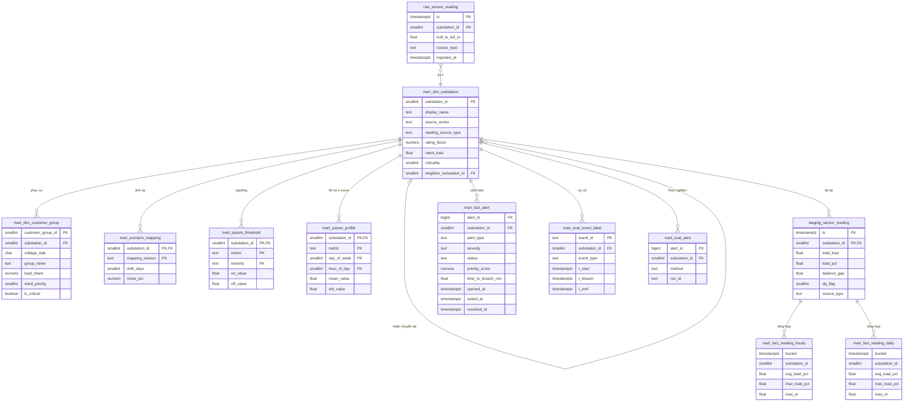

# ERD – Kho dữ liệu

## 1. Tổng quan
Kho dữ liệu chia thành 3 lớp:
- **raw:** dữ liệu nguyên vẹn.
- **staging:** dữ liệu đã làm sạch.
- **mart:** mô hình dim/fact phục vụ dashboard và đánh giá.

Mọi bảng đều xoay quanh `mart.dim_substation`, nối qua khóa `substation_id`.

## 2. Danh mục bảng

### Dữ liệu cảm biến

| Bảng | Loại | Grain (1 dòng là gì) | Khóa | Người ghi |
|---|---|---|---|---|
| raw.sensor_reading | Hypertable | 1 trạm × 15 phút | (substation_id, ts) | Producer |
| staging.sensor_reading | Hypertable | 1 trạm × 15 phút | (substation_id, ts) | Job ELT |
| staging.etl_watermark | Bảng thường | 1 job ELT | job_name | Job ELT |

### Fact (Mart)

| Bảng | Loại fact | Grain | Measure chính |
|---|---|---|---|
| fact_reading_hourly | Periodic snapshot (continuous aggregate) | 1 trạm × 1 giờ | avg/max load_pct, max ot, n_readings, n_dq_issues |
| fact_reading_daily | Periodic snapshot (continuous aggregate) | 1 trạm × 1 ngày | Như trên |
| fact_alert | Accumulating snapshot | 1 cảnh báo | priority_score và 4 điểm thành phần, time_to_breach_min, thời gian tiếp nhận và xử lý |

### Dimension và tham chiếu (Mart)

| Bảng | Nội dung | Người tạo dữ liệu |
|---|---|---|
| dim_substation | 4 trạm: hệ số định mức, rated_load, độ quan trọng, trạm lân cận | Trọng (rated_load do Thiện điền) |
| dim_customer_group | Nhóm khách hàng theo trạm và phía áp, kèm thứ tự sa thải | Trọng |
| scenario_mapping | Cách tạo trạm DERIVED: số ngày dời, mức nhiễu, seed | Trọng |
| param_threshold | Ngưỡng bật/tắt theo trạm, chỉ số và mức cảnh báo | Thiện |
| param_profile | Mean và std theo trạm × thứ × giờ | Thiện |

### Đánh giá (Mart)

| Bảng | Nội dung | Người tạo dữ liệu |
|---|---|---|
| eval_event_label | Nhãn sự cố đã bơm (đáp án): t_start, t_breach, t_end | Văn |
| eval_alert | Cảnh báo sinh ra khi chạy 3 phương pháp, phân biệt bằng method và run_id | Detector (chế độ thực nghiệm) |

### View
- **v_latest_reading:** bản ghi mới nhất của từng trạm, kèm tên trạm và độ quan trọng. Grafana dùng view này cho màn hình tổng quan.

## 3. Quan hệ
- **dim_substation tự tham chiếu:** `neighbor_substation_id` trỏ tới trạm nhận chuyển tải. Ví dụ Trạm Y (id 1) trỏ tới Trạm 3. Khóa ngoại này được đặt `DEFERRABLE`, nên nạp CSV không cần đúng thứ tự dòng.
- **dim_substation 1–n các bảng khác:** mọi bảng staging, fact, param và eval đều có khóa ngoại tới `dim_substation`.
- **Raw không có khóa ngoại:** để giữ dữ liệu nguyên vẹn, kể cả dữ liệu sai. Quan hệ với dim chỉ mang tính logic.
- **Continuous aggregate không có khóa ngoại:** đây là view tổng hợp từ Staging.

## 4. Quy ước

| Quy ước | Ý nghĩa |
|---|---|
| `source_type` | REAL = ETT gốc. DERIVED = dời thời gian và thêm nhiễu. SIMULATED = sự cố bơm vào |
| `attr_source = SIMULATED` | Thuộc tính trong dim do nhóm tự tạo, không phải dữ liệu thực tế |
| `dq_flag` (bitmask) | 0 = OK, 1 = có NULL, 2 = giá trị âm, 4 = lệch cân bằng H ≠ M + L |
| Thời gian sự kiện và thời gian xử lý | `ts`, `first_ts`, `t_start` thuộc thời gian dữ liệu, dùng để đánh giá. `ingested_at`, `processed_at`, `opened_at`, `acked_at` thuộc thời gian hệ thống, dùng để đo độ trễ và KPI |
| `day_of_week` | Theo ISO: 1 = Thứ 2, …, 7 = Chủ nhật. Khi so sánh phải dùng `EXTRACT(ISODOW ...)` |
| Vòng đời cảnh báo | OPEN → ACKNOWLEDGED → RESOLVED. Tự RESOLVED khi `below_off_count` đạt 2 |

## 5. Ràng buộc quan trọng
- **Chống trùng cảnh báo:** unique index `ux_alert_active (substation_id, alert_type) WHERE status <> 'RESOLVED'`. Mỗi trạm chỉ có 1 cảnh báo đang mở cho mỗi loại.
- **Hysteresis:** `param_threshold` có `CHECK (off_value < on_value)`.
- **Nhãn sự cố hợp lệ:** `t_start < t_end`, và `t_breach` (nếu có) nằm trong khoảng [t_start, t_end].
- **Điểm ưu tiên:** mọi điểm số nằm trong khoảng 0–1.