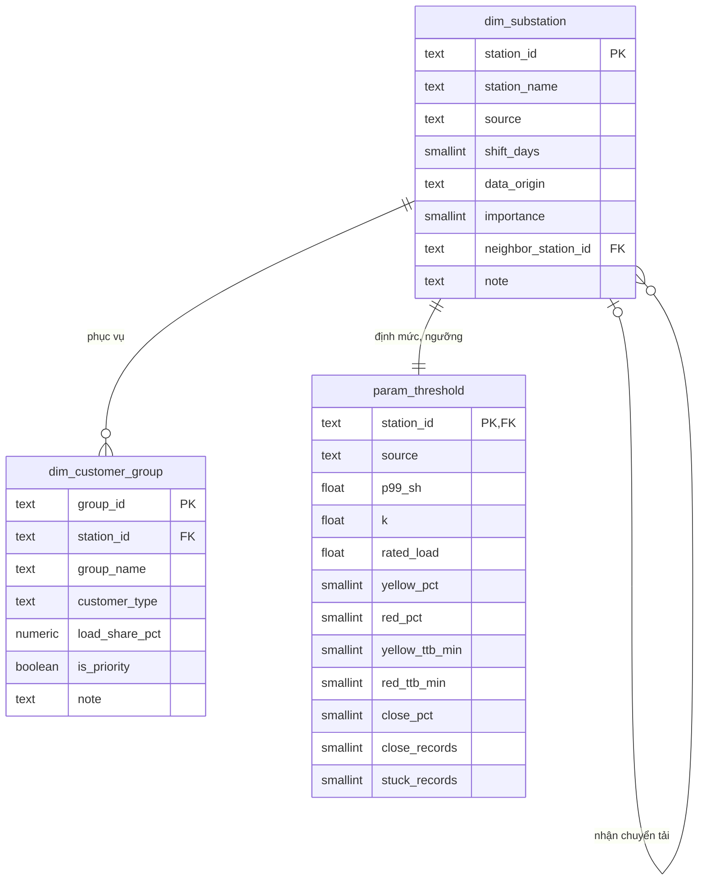
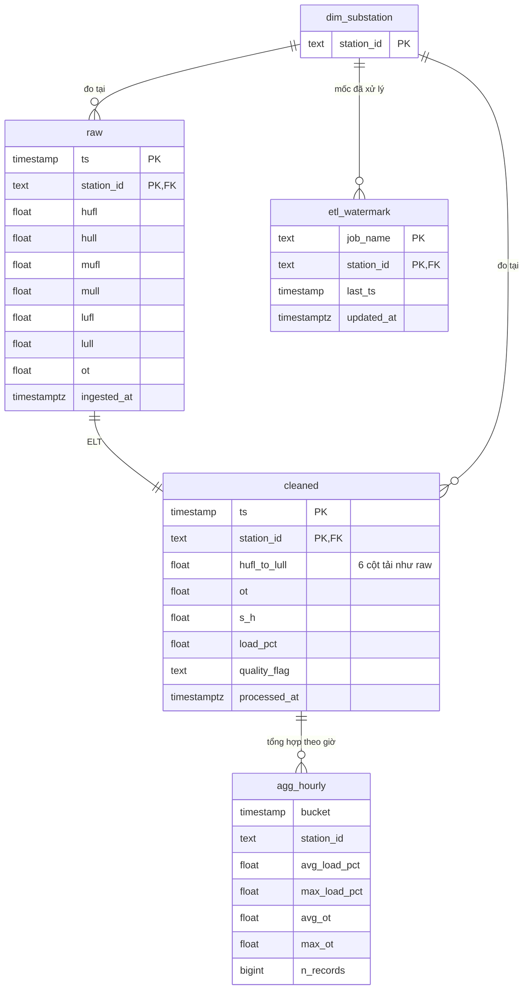
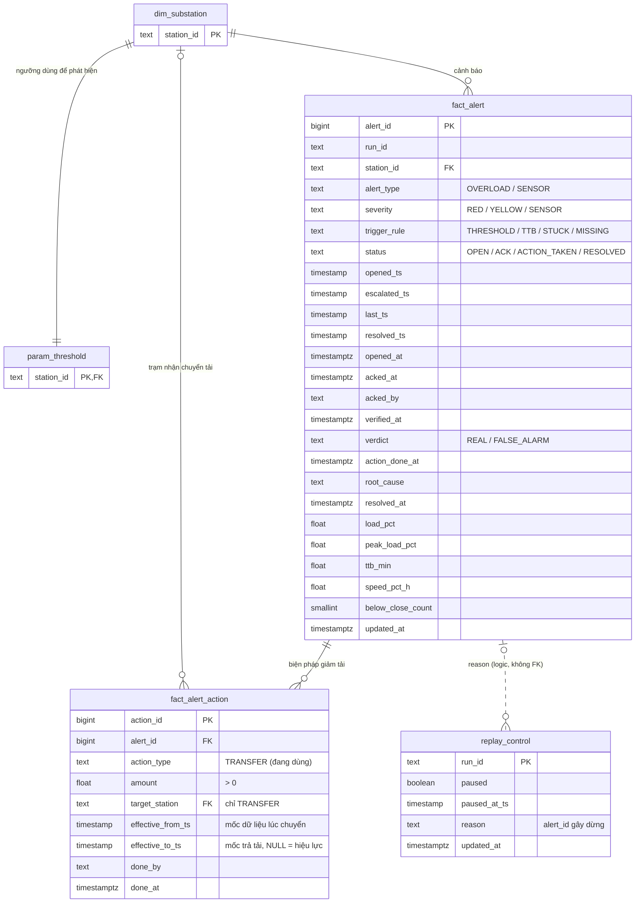
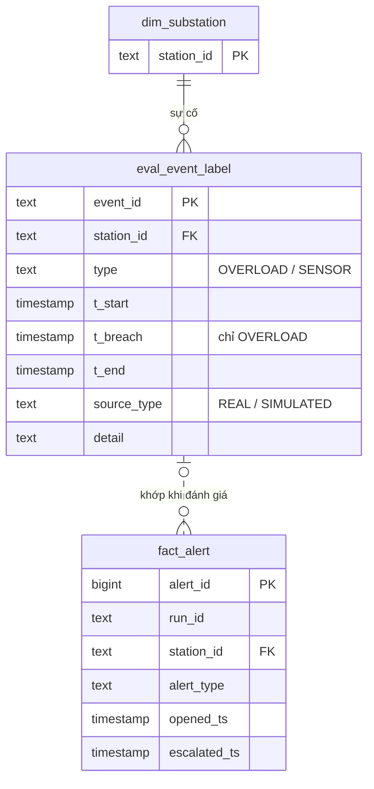
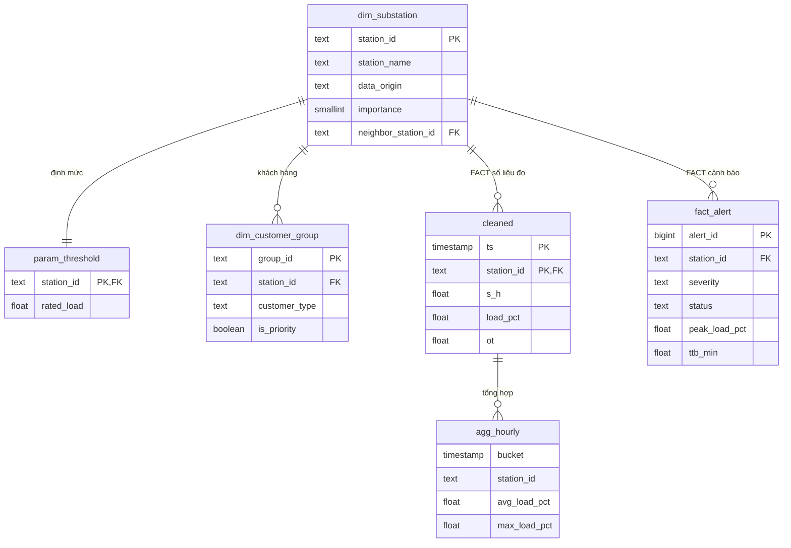

# ERD – Kho dữ liệu

## 1. Tổng quan
Kho chia thành 4 lớp. Mọi bảng nối với `dim_substation` qua khóa `station_id`.

| Lớp | Bảng | Vai trò |
|---|---|---|
| Tham chiếu | `dim_substation`, `dim_customer_group`, `param_threshold` | Mô tả trạm, khách hàng, định mức và ngưỡng |
| Cảm biến | `raw` → `cleaned` → `agg_hourly`, `etl_watermark` | Số liệu đo 15 phút, đã làm sạch và tổng hợp theo giờ |
| Cảnh báo | `fact_alert`, `fact_alert_action`, `replay_control` | Cảnh báo và vòng đời; biện pháp người trực chọn; trạng thái dừng phát lại |
| Đánh giá | `eval.event_label` | Đáp án sự cố, schema riêng, detector không đọc |

Phần 6 gộp các lớp trên thành star schema.

---

## 2. Lớp tham chiếu

| Bảng | Grain | Nội dung | Nguồn |
|---|---|---|---|
| dim_substation | 1 trạm | Nguồn ETT, số ngày dời, REAL/DERIVED, độ quan trọng (1–3), trạm lân cận | `001_schema.sql` (SIMULATED) |
| dim_customer_group | 1 nhóm khách hàng | Loại khách hàng, % tải của trạm, có ưu tiên giữ điện hay không | `001_schema.sql` (SIMULATED) |
| param_threshold | 1 trạm | `rated_load = p99_sh × k`; ngưỡng Vàng 90 / Đỏ 100 / đóng 85; TTB 60 / 30; đứng yên 4 bản ghi | `param_threshold.csv` (Task 1.2) |

- **Tự tham chiếu:** TRAM_Y → TRAM_3 và TRAM_2 → TRAM_4. Khóa ngoại đặt `DEFERRABLE` nên nạp dữ liệu không cần đúng thứ tự dòng.
- **Quan hệ 1–1** giữa `dim_substation` và `param_threshold`: mỗi trạm đúng 1 dòng tham số.

---

## 3. Lớp cảm biến

| Bảng | Loại | Grain | Khóa | Người ghi |
|---|---|---|---|---|
| raw | Hypertable | 1 trạm × 15 phút | (station_id, ts) | Producer |
| cleaned | Hypertable | 1 trạm × 15 phút | (station_id, ts) | Job ELT |
| agg_hourly | Continuous aggregate | 1 trạm × 1 giờ | (bucket, station_id) | TimescaleDB, refresh mỗi phút |
| etl_watermark | Bảng thường | 1 job × 1 trạm | (job_name, station_id) | Job ELT |

- `s_h = √(hufl² + hull²)`; `load_pct = s_h / rated_load × 100`.
- `raw` và `cleaned` **không có cột nhãn nguồn**, nên detector không thể nhìn đáp án.
- `n_records < 4` trong `agg_hourly` nghĩa là giờ đó thiếu bản ghi.

---

## 4. Lớp cảnh báo

| Thuộc tính | Giá trị |
|---|---|
| Loại fact | Accumulating snapshot (1 dòng được cập nhật suốt vòng đời) |
| Grain | 1 cảnh báo |
| Measure | `load_pct`, `peak_load_pct`, `ttb_min`, `speed_pct_h` |
| Mốc dữ liệu | `opened_ts` → `escalated_ts` (lên Đỏ) → `resolved_ts` |
| Mốc giờ thật | `opened_at` → `acked_at` → `verified_at` → `action_done_at` → `resolved_at` |
| Người ghi | Detector (mở, cập nhật, đóng); Streamlit (ACK, xác minh, hành động, nguyên nhân, báo giả) |

- **Vòng đời:** OPEN → ACK → ACTION_TAKEN → RESOLVED, khớp quy trình 3 bước Xác nhận → Chuyển tải → Theo dõi.
  - ① Xác nhận: `status = ACK`, `acked_by`, `acked_at`, `verdict = REAL`, `verified_at`; hoặc báo giả (xem dưới).
  - ② Chuyển tải: mỗi lần chuyển là 1 dòng `fact_alert_action` (TRANSFER, `amount`, `target_station`, `effective_from_ts`); lần đầu đặt `status = ACTION_TAKEN`, `action_done_at`.
  - ③ Theo dõi: `root_cause`. Detector đóng cảnh báo khi tải **sau chuyển tải** (`v_load_sim`) < 85% hai lần liên tiếp, và đặt `effective_to_ts` (trả tải) khi tải **đo** của trạm nguồn < 85% hai lần liên tiếp.
- **Báo giả:** `verdict = FALSE_ALARM`, `status = RESOLVED`, `resolved_ts = last_ts`. Chỉ dùng cho KPI vận hành; Recall/Precision vẫn chấm bằng `event_label`.
- **Bị bỏ lỡ:** cảnh báo Đỏ RESOLVED mà `acked_at` rỗng.
- Detector vẫn cập nhật số đo (`load_pct`, `ttb_min`, `peak_load_pct`, `last_ts`) của cảnh báo ACK / ACTION_TAKEN và đóng như bình thường, nhưng không ghi đè cột người trực nhập.
- **`run_id`:** LIVE (vận hành / phát lại, dashboard), EVAL_A, EVAL_B (đánh giá phương pháp). Không có bảng `eval_alert` riêng.

| Bảng | Grain | Người ghi | Ghi chú |
|---|---|---|---|
| fact_alert_action | 1 lần chuyển tải của 1 cảnh báo | Streamlit (detector đặt `effective_to_ts`) | Hiện chỉ dùng TRANSFER; `amount > 0`; `target_station` bắt buộc với TRANSFER; hiệu lực cho các mốc `ts ∈ (effective_from_ts, effective_to_ts]`; `done_at = now()` |
| replay_control | 1 run (LIVE) | Detector bật, Streamlit tắt | Detector UPSERT `paused = true`, `paused_at_ts = ts`, `reason = alert_id` khi một cảnh báo chuyển sang Đỏ (run LIVE). Không hiển thị trên dashboard. Producer đọc `paused` trước mỗi mốc `ts`. EVAL_A/EVAL_B không ghi |

---

## 5. Lớp đánh giá

| Thuộc tính | Giá trị |
|---|---|
| Bảng | `eval.event_label` (schema `eval`) |
| Grain | 1 sự cố |
| Nội dung | 38 sự cố: 9 OVERLOAD SIMULATED, 9 OVERLOAD REAL (Trạm Y), 20 SENSOR REAL |
| `detail` | INJECTED_RAMP, REAL_PEAK, DAY31_FILL, STUCK_HV |
| Nguồn | `event_label.csv` (Task 1.3) |

- **Quan hệ khớp với `fact_alert` là logic, không có khóa ngoại.** Một cảnh báo khớp một sự cố khi cùng `station_id`, cùng loại, và `opened_ts` ∈ [`t_start`, `t_end` + 1 giờ]. Nhiều cảnh báo cho cùng một sự cố chỉ tính 1 lần.
- **Chỉ số đánh giá:**
  - Độ trễ phát hiện = `opened_ts` − `t_start`.
  - Lead time = `t_breach` − `escalated_ts`.

---

## 6. Star schema
Hai bảng fact dùng chung dimension `dim_substation`. `param_threshold` và `dim_customer_group` là nhánh mở rộng của trạm (snowflake). Thời gian dùng trực tiếp cột `ts`, không có `dim_time`.

| Bảng | Vai trò | Grain | Dùng cho màn hình |
|---|---|---|---|
| cleaned | Fact số liệu đo (transaction) | 1 trạm × 15 phút | 1 Điều hành, 2 Chi tiết trạm |
| agg_hourly | Fact tổng hợp (periodic snapshot) | 1 trạm × 1 giờ | Tra cứu theo giờ |
| fact_alert | Fact cảnh báo (accumulating snapshot) | 1 cảnh báo | Điều hành, Chi tiết trạm |
| fact_alert_action | Fact chuyển tải (transaction) | 1 lần chuyển | Chi tiết trạm, Điều hành |
| dim_substation | Dimension trung tâm | 1 trạm | Tất cả |
| param_threshold | Mở rộng của trạm | 1 trạm | 2 Lượng cần giảm, trạm lân cận nhận tối đa |
| dim_customer_group | Mở rộng của trạm | 1 nhóm khách hàng | 1 Xếp hạng (khách hàng ưu tiên), 2 Khách hàng |

**View phục vụ dashboard**
| View | Nội dung |
|---|---|
| v_load_sim | Mỗi run × trạm × `ts`: số đo `s_h`, `load_pct` và tải sau chuyển tải (mô phỏng) `s_h_sim`, `load_pct_sim`, `transfer_out`, `transfer_in` |
| v_station_latest | Bản ghi mới nhất mỗi trạm × `run_id`: `ts`, `s_h`, `load_pct`, `s_h_sim`, `load_pct_sim`, `rated_load`, `ot`, `speed_pct_h` (trên tải mô phỏng); `load_level` theo **cảnh báo đang mở** của run đó (RED > YELLOW > SENSOR > NORMAL), không theo ngưỡng %; `ttb_min` của cảnh báo OVERLOAD đang mở |
| v_alert_queue | Xếp: đang mở trước → `severity_rank` (RED 1, YELLOW 2, SENSOR 3) → `floor(coalesce(ttb_min, 9999) / 10)` → `has_priority_customer` → `load_pct` cao. Cờ `has_priority_customer`, `is_escalated` (Đỏ OPEN > 3 phút, Vàng OPEN > 15 phút), `is_missed` (Đỏ RESOLVED chưa ACK), `response_sec` |

---

## 7. Quy ước

| Quy ước | Ý nghĩa |
|---|---|
| `station_id` | TRAM_Y, TRAM_2, TRAM_3, TRAM_4 |
| `*_ts` (TIMESTAMP) | Thời gian dữ liệu (2017–2018); dùng cho phát hiện và đánh giá |
| `*_at` (TIMESTAMPTZ) | Giờ thật (`now()`); dùng đo độ trễ và thời gian phản ứng |
| `data_origin` | Trong `dim_substation`. REAL = ETT gốc; DERIVED = dời ngày |
| `source_type` | Chỉ có trong `eval.event_label`. REAL = có sẵn trong dữ liệu gốc; SIMULATED = nhóm bơm vào |

## 8. Ràng buộc quan trọng
- **Chống trùng:** `ux_alert_one_open (run_id, station_id, alert_type) WHERE status IN ('OPEN','ACK','ACTION_TAKEN')`.
- **Loại khớp mức:** SENSOR ↔ severity SENSOR; OVERLOAD ↔ RED / YELLOW.
- **ACK hợp lệ:** status ACK bắt buộc có `acked_at` và `acked_by`.
- **Đã xử lý hợp lệ:** status ACTION_TAKEN bắt buộc có `action_done_at`.
- **Xác minh hợp lệ:** có `verdict` (REAL / FALSE_ALARM) thì bắt buộc có `verified_at`.
- **Chuyển tải:** `amount > 0`; TRANSFER ⇔ có `target_station`; TRANSFER bắt buộc có `effective_from_ts`; `effective_to_ts > effective_from_ts`.
- **Đóng hợp lệ:** status RESOLVED ⇔ có `resolved_ts`.
- **Lên Đỏ:** có `escalated_ts` thì severity phải là RED.
- **Ngưỡng hợp lệ:** `close_pct < yellow_pct < red_pct`; `red_ttb_min < yellow_ttb_min`.
- **Nhãn sự cố:** `t_start ≤ t_end`; OVERLOAD bắt buộc có `t_breach` ∈ [`t_start`, `t_end`]; SENSOR không có `t_breach`.